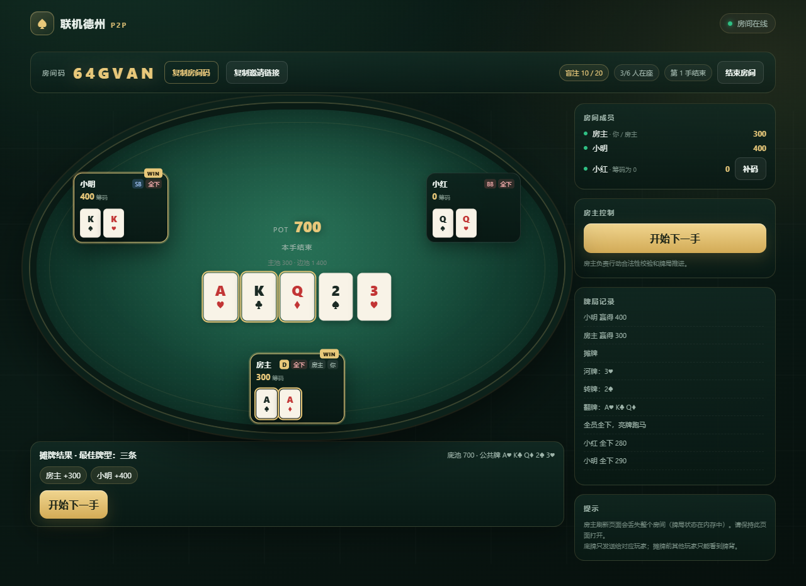

# 联机德州 · P2P Texas Hold'em

> GitHub Pages 上的轻量联机德州扑克：纯静态站点、PeerJS 公共信令、房主权威、无需自建后端。

**在线试玩：<https://beneuum-coder.github.io/poker-p2p/>**  
**仓库：<https://github.com/beneuum-coder/poker-p2p>**



---

## 这是什么

一个可以直接部署到 **GitHub Pages** 的 2–6 人联机德州扑克首版。房主在浏览器里创建房间并生成 6 位房间码，其他玩家打开同一个 Pages 链接、输入房间码即可加入；牌局状态与规则引擎都在房主浏览器内运行，其他玩家通过 PeerJS DataConnection 与房主通信。

- 前端：原生 HTML / CSS / JavaScript，构建产物是纯静态文件
- 联机：PeerJS 1.5.5 + 公共 PeerJS Cloud 信令服务器（不搭自建后端）
- 规则引擎：[texas-poker-core](https://www.npmjs.com/package/texas-poker-core) 1.4.35，运行在房主浏览器
- 架构：**房主权威 P2P**，房主负责行动合法性校验、状态推进、结算与状态广播

---

## 功能

- 2–6 人房间；房主创建房间、生成 6 位房间码；支持邀请链接 `?r=房间码`
- 完整一手牌：盲注（10 / 20）、发底牌、翻牌前 / 翻牌 / 转牌 / 河牌四轮下注、摊牌比牌、底池分配
- 操作：跟注、加注、下注、过牌、弃牌、全下
- 边池：多人不等额全下时由引擎拆分主池 / 边池并分别结算
- 隐私：底牌仅私发给对应玩家；公共牌、底池、筹码、行动状态广播给所有人；摊牌后才公开未弃牌玩家的底牌
- 断线恢复：玩家刷新页面或短暂断网后，凭本机保存的 token 恢复原座位、筹码和当前手牌
- **单人 / 机器人补位**：没人时房主可以直接开局，自动补 1 个机器人；也可手动添加机器人或一键补满 6 人；机器人分**低 / 中 / 高**三档，等级越高越难赢
- 房主操作：开始第 1 手、开始下一手、给 0 筹码玩家补码、添加机器人、切换机器人等级、结束房间

### 首版参数

| 参数 | 值 |
|---|---|
| 人数 | 2–6 |
| 初始筹码 | 1000 |
| 盲注 | 10 / 20 |
| 房间码 | 6 位（去除易混淆字符） |
| 状态保存 | 房主浏览器内存 + 玩家 localStorage token |

### 机器人说明

- 只有房主能添加机器人；开始第 1 手时如果不足 2 人，会自动补 1 个当前等级的机器人。
- 房主控制区可选择机器人等级：「低 · 陪练」「中 · 标准」「高 · 职业」；「添加机器人」「补满 6 人」都按当前等级创建。
- 等级差异：
  - **低 · 陪练**：入池很宽，愿意跟小注看到翻牌/河牌，适合轻松玩；人类最容易赢。
  - **中 · 标准**：位置 + 牌力 + 底池赔率平衡，有正常弃牌和诈唬。
  - **高 · 职业**：更紧、更重视赔率与价值下注，面对加注弃牌更多，最难打。
- 机器人由房主浏览器驱动，大约每 0.8 秒行动一次；翻后用蒙特卡洛胜率（40–80 次采样）+ 底池赔率 + 价值下注/诈唬频率。它不是 GTO/CFR 求解器。
- 机器人也受同一套行动合法性校验；它的底牌同样遵守“摊牌前不公开”。
- 机器人输光筹码后，下一手开始时会自动补码 1000，避免单人局卡住。
- 机器人随房主页面存在；房主关页后机器人也消失。

---

## 快速开始（玩家）

### 创建房间

1. 打开部署好的 Pages 链接。
2. 选择「创建房间」，输入昵称，点击创建。
3. 把页面上的 **6 位房间码** 或「复制邀请链接」分享给朋友。
4. 有人就等人入座；没人也可以直接点「开始第 1 手」，系统会自动补 1 个机器人。房主控制里还可以「添加机器人」或「补满 6 人」。

### 加入房间

1. 打开同一个 Pages 链接（或直接打开邀请链接 `.../?r=房间码`）。
2. 选择「加入房间」，输入房间码和昵称，点击加入。
3. 等待房主开始；如果本手正在进行，会在下一手自动入座。

> 刷新玩家页面会自动回座；刷新**房主**页面会丢失整个房间（状态在内存中）。机器人只存在于房主页面，房主关页后机器人也随房间消失。

---

## 部署到 GitHub Pages

仓库里已经包含构建好的 `docs/` 静态站点，二选一即可。

### 方式 A：从分支部署（最简单）

1. 在 GitHub 新建仓库，把本仓库推送到 `main`。
2. 仓库 **Settings → Pages → Build and deployment**：
   - Source 选择 **Deploy from a branch**
   - Branch 选择 **main**，目录选择 **/docs**
3. 保存后等待 Pages 构建，访问 `https://<你的用户名>.github.io/<仓库名>/`。

`docs/` 里包含 `.nojekyll`，不会走 Jekyll 处理。

### 方式 B：GitHub Actions 自动构建

仓库已附带 [`.github/workflows/pages.yml`](.github/workflows/pages.yml)。在 **Settings → Pages** 把 Source 改为 **GitHub Actions**，之后每次推送 `main` 会自动：

1. `npm ci`
2. `npm test`（规则单元测试）
3. `npm run build`
4. 上传 `docs/` 并部署

两种方式不要同时启用；方式 B 的 workflow 会重新生成 `docs/`。

### 本地预览

```bash
npm install
npm run build
npm run serve
# 打开 http://127.0.0.1:8080
```

同一台机器上想模拟多个玩家，请使用**两个独立浏览器 / 两个无痕窗口 / 两台设备**。同一个浏览器 profile 的普通多标签会共享 `localStorage` 里的 session token，可能互相顶号。

---

## 开发

```bash
npm install        # Node.js >= 20
npm test           # 规则引擎、隐私、边池、重连 token、机器人合法性等单元测试
npm run test:e2e   # 真浏览器 + 真 PeerJS 的端到端验收（需 Chromium）
npm run verify     # 上面两者串行执行
npm run build      # 生成 docs/ 静态站点
```

### E2E 浏览器

`npm run test:e2e` 使用 `playwright-core` 启动本机 Chromium。若没有浏览器：

```bash
npx playwright install chromium
```

脚本会依次查找 Playwright 缓存中的 Chromium；也可以显式指定：

```bash
# Windows PowerShell
$env:TXP_CHROMIUM="C:\path\to\chrome.exe"; npm run test:e2e
# macOS / Linux
TXP_CHROMIUM=/path/to/chrome npm run test:e2e
```

E2E 会启动本地静态服务器，真实走 PeerJS 公共信令 + WebRTC，覆盖：

1. 房主创建、玩家用房间码加入、互相可见
2. 发牌后底牌保密，摊牌后公开
3. 跟注 / 过牌 / 四轮推进 / 摊牌 / 底池分配 / 下一手庄家移动
4. 玩家刷新页面、断网 3.5 秒后自动重连，座位、筹码、底牌和当前手牌不丢失
5. 三人不等额全下，主池 300 归短码 AAA、边池 400 归 KK，筹码守恒
6. 单人模式：1 个真人直接开局，自动补机器人，机器人自动行动并进入下一手
7. 机器人等级：低/中/高可选，标签、创建流程与等级差异可验证

测试产物在 `test/.artifacts/`（截图 + `acceptance-report.json`），该目录默认不入库。

### 项目结构

```
.
├── src/
│   ├── main.js              # 页面渲染、交互、房间生命周期
│   ├── index.html
│   ├── styles.css
│   ├── game/table.js        # 房主权威牌桌封装、状态投影、隐私过滤
│   ├── game/bot.js          # 机器人牌力估计与合法行动选择
│   └── net/peer.js          # HostSession / GuestSession（PeerJS、重连、握手、机器人调度）
├── scripts/build.mjs        # esbuild 打包 + 拷贝静态资源到 docs/
├── docs/                    # 构建产物（可直接部署）
├── test/
│   ├── unit/                # Node 单元测试
│   ├── e2e/                 # Playwright 端到端验收
│   └── helpers/             # 静态服务器 / 浏览器定位
├── assets/screenshot.png
└── .github/workflows/pages.yml
```

### 状态与隐私实现要点

- `PokerTable.getState(viewerId)` 是唯一的状态投影入口。每位玩家的 `players[].cards` 只会在**摊牌后**填写；`you.cards` 只包含查看者自己的底牌。房主广播时对每个连接分别调用 `getState(对方 playerId)`，不会把全量底牌发出去。
- 房主浏览器内存中当然持有全部底牌，因此「房主技术上可信、可作弊」是明确边界。
- 每个玩家入座时房主生成随机 token；玩家保存在 `localStorage["txp:session:<房间码>"]`。刷新后向房主发送 `hello(token)`，房主命中同一玩家记录则恢复原座位与筹码，不新建玩家。
- 玩家侧 `GuestSession` 在信令断开、DataChannel 关闭、心跳超时、浏览器 `online` / 页面重新可见时自动重连，指数退避（约 0.9s → 6s）。
- 结算以 `texas-poker-core` 的 `PotAwarded.allocations` 为准；UI 里的主池 / 边池拆分仅用于展示。

---

## 验收对照

以下结果来自本机真实浏览器 + 公共 PeerJS 信令的 E2E（`npm run test:e2e`），报告在 `test/.artifacts/acceptance-report.json`。

| 验收项 | 结果 | 证据 |
|---|---|---|
| 联机建立：另一设备/浏览器输入房间码，数秒内互相看到加入 | ✅ | E2E 场景 1：房主 + 玩家两独立 BrowserContext，双方房间成员均显示 2/6 人 |
| 完整一手牌：盲注扣除、公共牌/底池同步、摊牌判胜负并分池 | ✅ | 单元测试 13 项 + E2E 场景 1；盲注 10/20、四轮推进、奖励总和等于底池 |
| 底牌保密：摊牌前互不可见，摊牌后公开 | ✅ | E2E 场景 1：摊牌前对手 2 张牌背；摊牌后双方各见 2 张明牌；单元测试校验 `getState` 不含对手底牌 |
| 断线恢复：刷新/短暂断网后座位、筹码不丢失，能继续当前手牌 | ✅ | E2E 场景 1：翻牌圈刷新页面 + 断网 3.5 秒后恢复，阶段/底池/筹码/底牌一致 |
| 边池：多人不等额全下时分配正确 | ✅ | 单元测试 + E2E 场景 2：短码 100（AAA）赢主池 300，300 的 KK 赢边池 400，QQ 0，筹码守恒 |
| 2–6 人房间与房间码 | ✅ | 单元测试「房间上限 6 人」；E2E 3 人实际联机 |
| 单人 / 机器人补位 | ✅ | E2E 场景 3：单人房自动补 1 个机器人，机器人自动行动并完成结算，下一手继续；破产机器人下一手自动补码 |
| 机器人等级 | ✅ | E2E 场景 4：低/高等级可切换，BOT 标签与房间人数正确；单元测试验证低等级更愿意跟注看翻牌 |

最近一次 E2E 结果（耗时随机器变化）：

```text
✅ 联机建立 + 完整一手牌 + 底牌保密 + 断线恢复 + 下一手
✅ 边池：三人不等额全下，主池与边池分配正确
✅ 单人模式：自动补机器人、机器人自动行动、下一手继续
✅ 机器人等级：低/中/高可选，标签与创建流程正确

验收全部通过。
```

独立验收报告（另一执行方，含 6 人满房、第 7 人被拒、wire 隐私反证等）：
[`verification/verifier-report.md`](verification/verifier-report.md)。

---

## 已知边界（首版）

- **房主浏览器技术上可信，房主可作弊**；仅适合朋友娱乐，不承诺陌生人防作弊。
- PeerJS 公共信令服务可用性依赖第三方；复杂 NAT 下 P2P 直连可能失败，首版不强制 TURN 中继。企业网络可能直接阻断 WebRTC。
- 牌局状态在房主浏览器内存中；**刷新房主页面会丢失房间**。玩家刷新不受影响。
- 没有账号、匹配、聊天、旁观模式、手牌历史持久化、自动超时弃牌、保险/ straddle 等进阶功能。
- 房主若长期离线，玩家会持续重连；当前版本没有「托管人类玩家 / 自动代打」。
- 机器人是房主浏览器内的启发式策略，不是强 AI / GTO 求解器；会按位置、牌力、底池赔率做跟注/加注/弃牌与价值下注，但不做复杂范围建模、对手建模或 CFR 求解。机器人随房主页面存在，房主关页即消失。
- 0 筹码玩家会在下一手开始前自动离座；房主可在局间为其补码（1000）。
- 断线玩家会保留座位与筹码；首版没有「移除 / 踢人」入口，6 人满房时若有玩家永久离开，需结束房间重开。
- 房主进程被强制关闭 / 网络黑洞时，玩家端依赖约 45 秒的心跳阈值，最长约 45–60 秒后才显示断线横幅；普通刷新与短时断网不受影响。

---

## 第三方

- [texas-poker-core](https://www.npmjs.com/package/texas-poker-core) — ISC，德州规则引擎（打包进 `docs/app.js`）
- [PeerJS](https://peerjs.com/) — MIT，WebRTC 封装与公共信令
- [esbuild](https://esbuild.github.io/) — MIT，构建工具
- [Playwright](https://playwright.dev/) — Apache-2.0，仅测试使用

详见 [THIRD_PARTY_NOTICES.md](THIRD_PARTY_NOTICES.md)。

## License

MIT，见 [LICENSE](LICENSE)。
